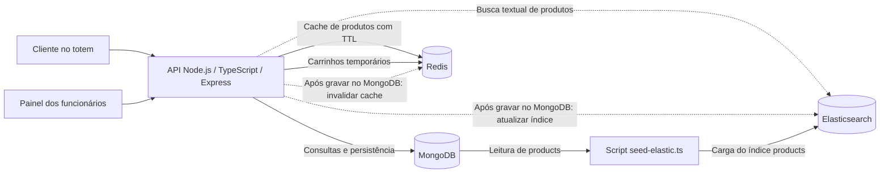

# Checkpoint 2 — Sistema de Autoatendimento por Totens

**Disciplina:** Banco de Dados NoSQL — TSI34E-TSI4  
**Instituição:** UTFPR — Campus Guarapuava  
**Professor:** Marcelo Vichar  
**Integrantes:** Eduardo Padilha do Nascimento, Emilly Zatti e Marcos Vinicius Olenka de Macedo  
**Repositório:** https://github.com/eduardo-padilha-dev/api-totem-ordering-system

## Seção 1 — Arquitetura e fonte da verdade

O sistema atende clientes em totens de restaurantes e funcionários que consultam o cardápio, a fila de preparo e os relatórios de vendas. A API Node.js com TypeScript e Express centraliza o acesso aos bancos. Cada banco tem uma responsabilidade: MongoDB armazena os dados persistentes do negócio, Redis atende leituras de cache e mantém carrinhos temporários, e Elasticsearch permite pesquisar produtos por texto e relevância.

### Diagrama da arquitetura

O diagrama representa a arquitetura prevista para o Checkpoint 2. As linhas tracejadas indicam fluxos que ainda precisam ser implementados. O acesso ao Elasticsearch para carga inicial é feito pelo script de indexação, usando os produtos do MongoDB.



Os bancos não se sincronizam diretamente entre si. A aplicação coordena as alterações e o script de indexação permite reconstruir o índice de busca a partir do MongoDB.

### Distribuição dos dados e fonte da verdade

Fonte da verdade é o banco em que um dado é gravado originalmente e cuja versão prevalece quando existe divergência com uma cópia. As coleções e os campos persistidos seguem o schema em inglês adotado pela API.

| Tipo de dado | Banco de gravação original / fonte da verdade | Cópias em outros bancos | Justificativa |
|---|---|---|---|
| Lojas: identificação, endereço, situação e configurações | MongoDB, coleção `stores` | Nenhuma prevista neste recorte | São dados persistentes, usados para identificar a unidade e validar se ela pode atender. |
| Categorias: nome, descrição, ordem e situação | MongoDB, coleção `categories` | O `category_id` dos produtos também aparece no índice Elasticsearch | A categoria completa permanece no MongoDB. A referência no índice permite filtrar os produtos por categoria, sem duplicar seu cadastro completo. |
| Produtos: nome, descrição, preço em centavos, loja, categoria, estoque e disponibilidade | MongoDB, coleção `products` | Elasticsearch, índice `products`; Redis, cache do detalhe do produto | Elasticsearch mantém uma projeção para busca textual e filtros. Redis mantém uma cópia temporária da resposta de leitura para reduzir consultas repetidas ao MongoDB. Nenhuma dessas cópias substitui o cadastro original. |
| Detalhes dos produtos: ingredientes, tags, informações nutricionais e grupos de personalização | MongoDB, embutidos em `products` | Ingredientes e tags no Elasticsearch; detalhes retornados pela rota no cache Redis | Ingredientes participam da busca textual e tags permitem filtros exatos. Nutrição e personalizações continuam no documento do produto e integram a resposta cacheada, sem precisar fazer parte do índice de busca. |
| Pedidos confirmados: loja, totem, status, itens, totais e datas | MongoDB, coleção `orders` | Nenhuma prevista neste recorte | O histórico precisa sobreviver à expiração de carrinhos e sustenta a fila de preparo e os relatórios. Os itens guardam nomes e preços históricos, sem depender do preço atual do catálogo. |
| Carrinho em andamento, identificado por sessão do totem | Redis, estrutura Hash com TTL, descrita na Seção 3 | Nenhuma enquanto o carrinho não for confirmado | É um estado temporário que precisa de acesso rápido e pode expirar por inatividade. Sua expiração não apaga pedidos confirmados. |
| Indicadores de vendas e ranking de produtos vendidos | Calculados a partir de `orders` no MongoDB | Nenhuma prevista neste recorte | Os relatórios atuais usam agregações dos pedidos concluídos. Seus resultados são derivados dos pedidos, sem constituir um segundo cadastro persistente. |

O cache de produto não é uma entidade independente: é uma cópia descartável de uma leitura do MongoDB. Se uma chave expirar, a próxima leitura deverá buscar o dado original e preencher o cache novamente. O carrinho, por sua vez, nasce no Redis e é a fonte do estado temporário daquela sessão. Caso o fluxo de confirmação seja implementado, deverá revalidar os itens e preços no MongoDB antes de criar um pedido; o carrinho não é uma fonte confiável para valores comerciais definitivos.

### Coerência entre os bancos

O fluxo previsto para uma alteração de produto é gravar primeiro no MongoDB, atualizar o documento correspondente no Elasticsearch e invalidar o cache desse produto no Redis. O índice utiliza o mesmo identificador do produto no MongoDB, convertido para texto, permitindo localizar a cópia que deve ser atualizada.

Essa sequência não constitui uma transação atômica entre os três bancos. Se uma atualização da cópia falhar, o dado persistido no MongoDB continua sendo a referência. O tratamento das falhas, a recuperação da sincronização e o prazo de visibilidade das alterações serão implementados e detalhados na Seção 6.

### Estado atual da implementação

O projeto já possui as quatro coleções MongoDB, as consultas do catálogo, da fila de preparo e dos relatórios, além das conexões com Redis e Elasticsearch. O mapping e o script de carga foram adaptados ao catálogo `products`. A indexação foi validada nos serviços em execução e é executada automaticamente pelo `iniciar.sh`, conforme a Seção 4.

O cache-aside do detalhe do produto está implementado conforme a Seção 2. O carrinho Redis está implementado conforme a Seção 3. Rota de busca e escrita com sincronização ainda não estão implementadas. Esta seção registra a arquitetura a ser concretizada nas próximas etapas e deverá ser atualizada caso alguma dessas decisões mude.

## Seção 2 — Redis como cache

### Rota e padrão cache-aside

A rota `GET /api/products/:id?store_id=<ObjectId>` utiliza Redis para armazenar temporariamente o detalhe de um produto. O corpo da resposta continua sendo `{ "data": { ... } }`, com os mesmos campos anteriores: identificador, nome, descrição, preço em centavos, categoria, ingredientes, tags, nutrição e grupos de personalização.

Antes de consultar o cache, a API valida os identificadores e consulta o MongoDB para verificar se a loja está ativa, se o produto pertence à loja, está disponível e tem estoque positivo, e se sua categoria está ativa. Essas validações acontecem inclusive em um HIT: o cache não autoriza a exibição de um produto que deixou de estar elegível. As verificações não constituem reserva de estoque nem uma transação; o estado ainda pode mudar após a consulta.

Em seguida, o fluxo é:

1. Consultar a chave no Redis.
2. Se houver uma cópia, retornar seu conteúdo com o cabeçalho `X-Cache: HIT`.
3. Se a chave estiver ausente, buscar o detalhe no MongoDB e gravá-lo no Redis com TTL, retornando `X-Cache: MISS`.
4. Se a leitura ou gravação no Redis falhar, retornar o detalhe obtido no MongoDB com `X-Cache: BYPASS`. Erros do MongoDB continuam sendo tratados pela rota; o cache não substitui as validações do banco principal.

Respostas 400, 404 e 500 não são armazenadas. O HIT evita a leitura completa do produto, mas mantém as consultas de validação. Portanto, o benefício é reduzir a transferência dos detalhes do produto, sem eliminar todo acesso ao MongoDB.

### Chave, conteúdo e expiração

| Item | Definição e motivo |
|---|---|
| Chave | `totem:product:<store_id>:<product_id>`. Os IDs são normalizados como texto hexadecimal; a loja explicita o contexto da leitura. |
| Conteúdo | JSON do objeto `data` da resposta, sem dados de sessão ou carrinho. ObjectIds são serializados como texto, preservando o formato JSON observado pelo cliente. |
| TTL | 60 segundos, aplicado com `SET ... EX 60`. Limita a duração de uma cópia antiga e permite reutilizar o detalhe em consultas próximas. |
| Renovação | O TTL começa na gravação em um MISS. Leituras HIT não renovam o prazo. Ao expirar, a próxima leitura elegível consulta o MongoDB e preenche a chave novamente. |
| Falha no Redis | A API aguarda a falha reportada pelo cliente Redis e segue pelo MongoDB. O fallback não significa ausência de latência: tentativas de conexão podem atrasar a resposta. |

### Invalidação

Nesta etapa, a chave deixa de valer automaticamente ao expirar. Ainda não existe uma rota de escrita de produtos; a invalidação explícita será implementada na Seção 6, apagando a chave correspondente após a gravação no MongoDB. Até lá, uma alteração direta no banco pode deixar nome, descrição ou preço antigos no cache por até o restante do TTL. Loja inativa, categoria inativa e produto indisponível ou sem estoque são bloqueados pelas validações anteriores ao cache.

### Verificação

Com MongoDB, Redis e API em execução, obtenha IDs reais do catálogo e execute duas vezes, em menos de 60 segundos:

```bash
curl -i "http://localhost:3400/api/products/<product_id>?store_id=<store_id>"
```

Para uma chave inicialmente ausente, a primeira resposta deve apresentar `X-Cache: MISS` e a segunda `X-Cache: HIT`, com o mesmo JSON. Após 60 segundos desde o preenchimento, uma nova chamada deve apresentar MISS, desde que nenhuma outra chamada tenha repopulado a chave. O roteiro completo de demonstração será consolidado na Seção 7.

Os testes isolados do controller são executados com `cd app && npm test` usando Node.js 22.3 ou superior, necessário para o recurso experimental `mock.module` do runner nativo. Eles substituem apenas os acessos externos aos bancos e verificam o comportamento da rota; não comprovam a expiração em um servidor Redis real.

## Seção 3 — Redis como estrutura de dados

### Carrinho temporário com Hash

Cada sessão do totem tem um carrinho armazenado em um Hash Redis. A chave segue o padrão `totem:cart:<session_id>`. O campo `store_id` identifica a loja, e cada campo `item:<product_id>` armazena a quantidade daquele produto como texto decimal. Por exemplo:

```text
Key: totem:cart:demo-totem-01
Type: Hash
store_id                         <store_id>
item:<product_id>                2
TTL                              1800 segundos
```

Hash permite localizar, substituir ou remover um item sem regravar uma lista completa. Nesta etapa, cada produto ocupa um único campo: adicionar novamente o mesmo produto substitui sua quantidade, sem duplicar a linha. O vínculo da loja é conferido junto da alteração do Hash em uma operação atômica no Redis, usando `HGET`, `HSET`, `HDEL`, `HLEN`, `EXPIRE` e `DEL` em um script Lua. Isso impede que duas requisições concorrentes vinculem o mesmo carrinho a lojas diferentes.

### Rotas e validações

As três rotas exigem os parâmetros de query `session_id` e `store_id`. A sessão deve ter de 1 a 128 caracteres, usando apenas letras ASCII, números, hífen ou underscore. A loja e os produtos usam ObjectIds. A sessão é um identificador operacional fornecido pelo cliente; não representa autenticação. O cliente deve usar identificadores distintos para sessões de atendimento distintas.

| Rota | Comportamento |
|---|---|
| `PUT /api/cart/items/:productId` | Recebe JSON `{ "quantity": 2 }` e define a quantidade absoluta do produto. Cria o carrinho se não existir. |
| `GET /api/cart` | Retorna `{ "data": { "session_id": "...", "store_id": "...", "items": [{ "product_id": "...", "quantity": 2 }] } }`. Carrinho inexistente ou expirado retorna `items: []`. |
| `DELETE /api/cart/items/:productId` | Remove o item. Se era o último, apaga a chave inteira. A resposta identifica o produto removido e informa `quantity: 0`. Remover um item inexistente também é permitido. |

A API verifica a loja ativa nas três rotas. Na inclusão ou alteração, o produto deve pertencer à loja, estar disponível, ter categoria ativa e estoque positivo. A quantidade deve ser um número inteiro de 1 a 99 e não pode superar o estoque atual. Não há reserva de estoque: a consulta valida apenas a disponibilidade naquele momento.

O carrinho não aceita personalizações nesta etapa. Produtos com seleção obrigatória em algum grupo de personalização são rejeitados com 422. Produtos com grupos opcionais podem entrar sem adicionais. O Hash não armazena preços: a interface consulta o preço atual pelo detalhe do produto no catálogo. A leitura do carrinho retorna as escolhas da sessão, sem revalidar cada item; um item pode ter se tornado indisponível desde sua inclusão. Uma futura confirmação deverá revalidar preços, opções, disponibilidade e estoque no MongoDB antes de criar um pedido.

Parâmetros inválidos retornam 400; loja ou produto inelegível, 404; quantidade acima do estoque ou conflito com a loja de um carrinho existente, 409. Na inclusão, a validação do produto ocorre antes da alteração Redis: um produto de outra loja pode retornar 404 antes da detecção do conflito de sessão. Uma falha Redis retorna 503, pois o carrinho nasce nesse banco e não possui cópia no MongoDB. Uma falha de validação por indisponibilidade do MongoDB retorna 500.

### Expiração

O TTL é de **1.800 segundos (30 minutos)**, suficiente para uma sessão de escolha no totem sem manter carrinhos abandonados indefinidamente. Inclusão, alteração de quantidade e remoção renovam o prazo para 30 minutos enquanto houver itens. Consultar o carrinho não renova o TTL. Quando expira, as escolhas temporárias são descartadas; pedidos confirmados no MongoDB não são afetados. Um conflito de loja não altera os dados nem renova o prazo.

### Demonstração

Substitua os IDs abaixo por um produto disponível e sua loja. Use uma sessão nova para iniciar com carrinho vazio. A ordem permite comprovar criação, alteração e remoção:

```bash
STORE_ID='<store_id>'
PRODUCT_ID='<product_id>'
SESSION_ID='demo-totem-01'
CART_URL="http://localhost:3400/api/cart"
CART_QUERY="session_id=$SESSION_ID&store_id=$STORE_ID"

# 200; data.items: [] em uma sessão nova.
curl -s "$CART_URL?$CART_QUERY"

# 200; data.quantity: 2.
curl -s -X PUT "$CART_URL/items/$PRODUCT_ID?$CART_QUERY" \
  -H 'Content-Type: application/json' -d '{"quantity":2}'

# 200; data.items contém o produto com quantity: 2.
curl -s "$CART_URL?$CART_QUERY"

# 200; substitui a quantidade por 3 (não soma 3).
curl -s -X PUT "$CART_URL/items/$PRODUCT_ID?$CART_QUERY" \
  -H 'Content-Type: application/json' -d '{"quantity":3}'

# Exibe store_id e item:<product_id> com valor 3.
docker compose exec -T redis redis-cli HGETALL "totem:cart:$SESSION_ID"

# Retorna um valor positivo de até 1800, conforme o tempo decorrido.
docker compose exec -T redis redis-cli TTL "totem:cart:$SESSION_ID"

# 200; data.quantity: 0 e chave removida se este era o único item.
curl -s -X DELETE "$CART_URL/items/$PRODUCT_ID?$CART_QUERY"

# 200; data.items: [].
curl -s "$CART_URL?$CART_QUERY"
```

A demonstração com quantidades 2 e 3 exige um produto com pelo menos três unidades em estoque. Os testes reais nos containers confirmaram o tipo Hash, a substituição da quantidade, o TTL de 1.800 segundos, a ausência de renovação em GET, a renovação em PUT e a exclusão da chave ao remover o último item. Os testes isolados adicionais são executados por `cd app && npm test`.

## Seção 4 — Elasticsearch: mapping e indexação

### Índice e tipos dos campos

O índice `products` recebe uma projeção do catálogo MongoDB. Seu mapping é versionado em `init/elastic-init.json`, sem o parâmetro `boost`. Pesos de relevância serão definidos na consulta da Seção 5, sem alterar o mapping.

| Campos | Tipo Elasticsearch | Justificativa |
|---|---|---|
| `product_id`, `store_id`, `category_id` | `keyword` | Identificadores precisam de correspondência exata, sem divisão em palavras. Os ObjectIds do MongoDB são convertidos para texto hexadecimal. |
| `name`, `description`, `ingredients` | `text` | São textos pesquisáveis por palavras e relevância. Usam o analisador `standard` padrão do Elasticsearch; cada ingrediente continua sendo um elemento do array. |
| `tags` | `keyword` | Marcadores do catálogo são valores completos, usados para filtros exatos. |
| `price_cents` | `integer` | Preserva o valor inteiro em centavos, compatível com o catálogo, sem conversão para ponto flutuante. |
| `stock` | `integer` | Representa a quantidade disponível e permite filtros numéricos. |
| `available` | `boolean` | Permite filtrar a disponibilidade definida pela loja. |

O índice utiliza um shard primário e zero réplicas, adequado ao ambiente acadêmico com um único nó. Essa configuração não oferece redundância. Informações nutricionais, grupos de personalização e pedidos não são indexados neste recorte: permanecem no MongoDB e são consultados pelas rotas correspondentes.

### Carga do MongoDB para o Elasticsearch

O script `app/src/scripts/seed-elastic.ts`, executado por `npm run seed:elastic`, conecta aos dois bancos, lê o mapping e recria o índice `products`. Em seguida, lê a coleção MongoDB `products` e indexa cada documento com `_id` igual ao identificador original convertido para texto. Os campos indexados são os listados na tabela acima.

São carregados todos os produtos, inclusive indisponíveis e sem estoque. Assim, o índice contém uma projeção completa do catálogo; a rota de busca deverá aplicar filtros de elegibilidade e validar o contexto da loja e da categoria na Seção 5. A indexação inicial não transforma o Elasticsearch na fonte da verdade.

Ao terminar a carga, o script executa um refresh explícito para tornar os documentos pesquisáveis antes de informar sucesso. As conexões são fechadas em um bloco `finally`, inclusive se a criação do índice ou alguma indexação falhar. Um erro encerra o comando com código diferente de zero.

O seed faz uma reconstrução completa: se o índice já existir, ele é apagado e criado novamente com o mapping versionado. Isso evita documentos antigos e duplicação após nova carga. Durante a reconstrução, a busca fica temporariamente indisponível; uma falha pode deixar o índice incompleto. A recuperação nesta etapa é repetir o seed a partir do MongoDB, que não é alterado pelo processo. Não há troca de índices sem interrupção nem snapshot transacional: alterações concorrentes no catálogo durante a carga não são cobertas por esta rotina de desenvolvimento.

### Inicialização automática

O comando `./iniciar.sh` realiza a sequência:

1. Seleciona o acesso ao Docker disponível no ambiente, mantendo a mesma forma de acesso em todas as etapas.
2. Executa `docker compose up -d --build --remove-orphans --wait --wait-timeout 180`.
3. Aguarda os health checks dos bancos; a API depende de MongoDB, Redis e Elasticsearch saudáveis antes de iniciar. A verificação MongoDB usa o endereço do serviço, evitando considerar pronto o servidor temporário de inicialização que só atende em loopback.
4. Executa os comandos opcionais de `init/redis-init.commands`, ignorando comentários e linhas vazias.
5. Executa `docker compose exec -T app npm run seed:elastic`.
6. Só apresenta a mensagem de ambiente pronto quando as etapas anteriores terminam com sucesso.

Uma falha de prontidão ou indexação interrompe o script. Os containers permanecem disponíveis para inspeção de logs; o script não apaga volumes. Portas ocupadas são reportadas pelo Docker, sem encerrar outros processos. É necessário Docker Compose com suporte a `up --wait`.

Reexecutar `./iniciar.sh` reconstrói o índice a partir do catálogo atual. Reiniciar apenas o container da API não executa o seed. Alterações posteriores no MongoDB ainda não atualizam o índice automaticamente: a escrita sincronizada será implementada na Seção 6.

### Verificação e demonstração

```bash
# Sobe os serviços e cria/carrega o índice sem passos manuais adicionais.
./iniciar.sh

# Exibe o mapping descrito nesta seção.
curl -s 'http://localhost:9234/products/_mapping?pretty'

# No dataset inicial, retorna count: 12.
curl -s 'http://localhost:9234/products/_count?pretty'

# Permite comparar os IDs e os campos indexados com o catálogo MongoDB.
curl -s 'http://localhost:9234/products/_search?size=20&pretty'

# Reconstrução manual, caso seja necessário recuperar uma carga com falha.
docker compose exec -T app npm run seed:elastic
```

A execução nos containers confirmou 12 produtos no MongoDB e 12 documentos no Elasticsearch, com igualdade de todos os campos projetados e os mesmos IDs. O health check da API retornou HTTP 200. Os testes isolados cobrem o mapping aplicado, a projeção, o refresh e a liberação de conexões em caso de falha; testes do script verificam a ordem de execução e que falhas não anunciam ambiente pronto. A validação desta etapa preservou os volumes existentes; o ensaio completo a partir de um clone com volumes novos permanece para a validação final da entrega.
